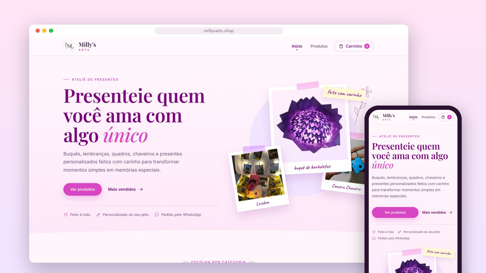
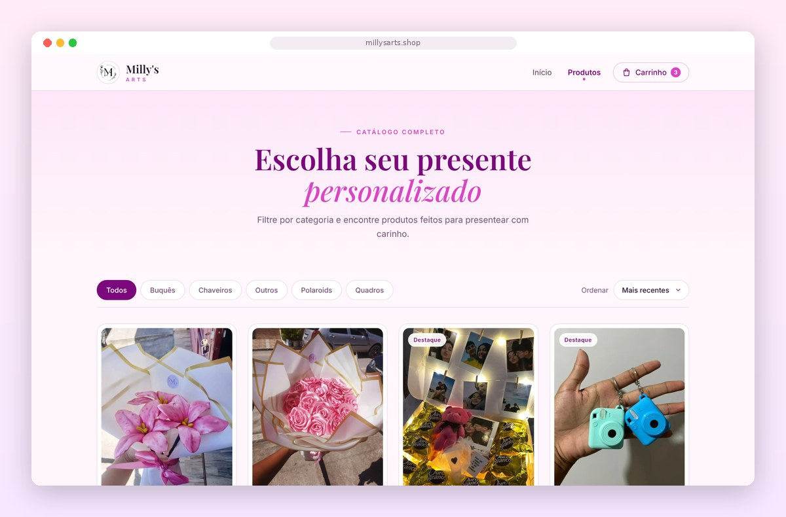
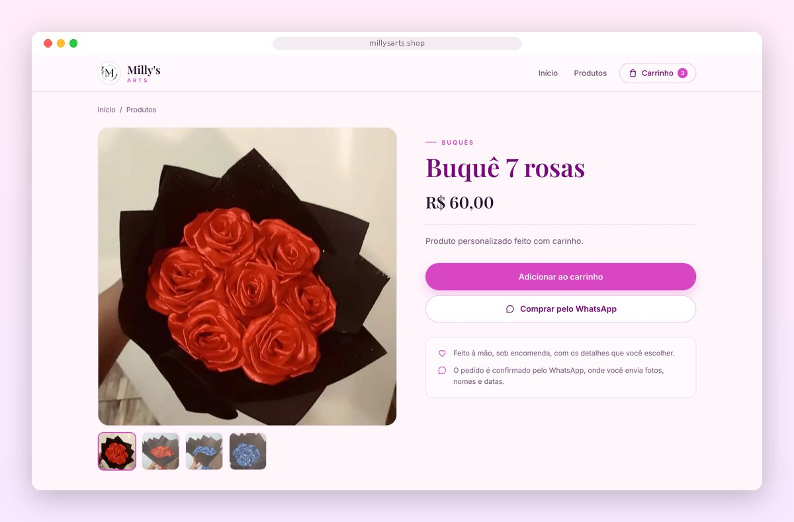
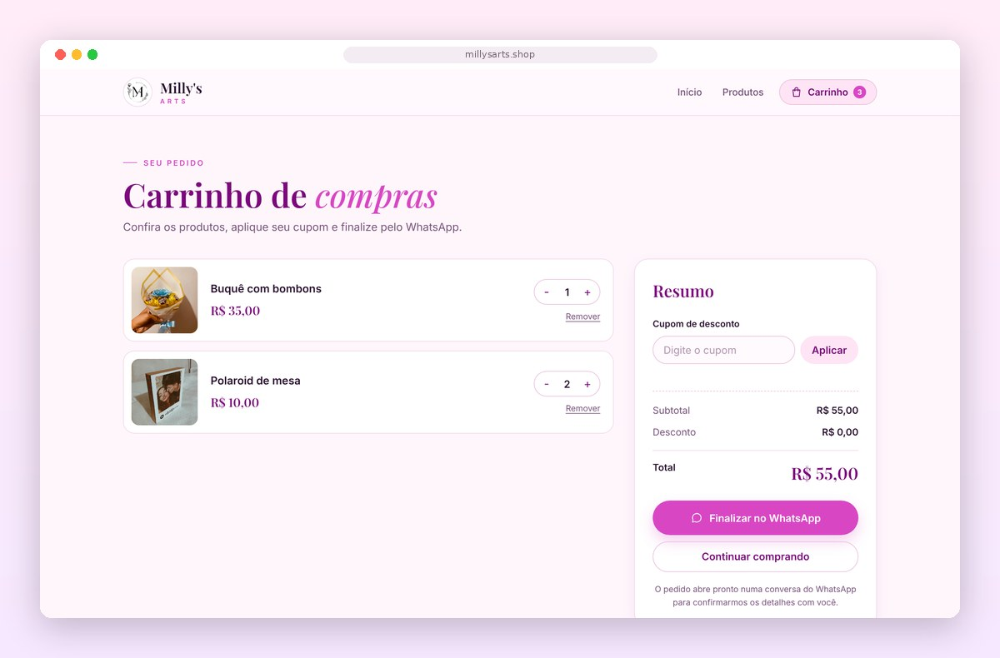
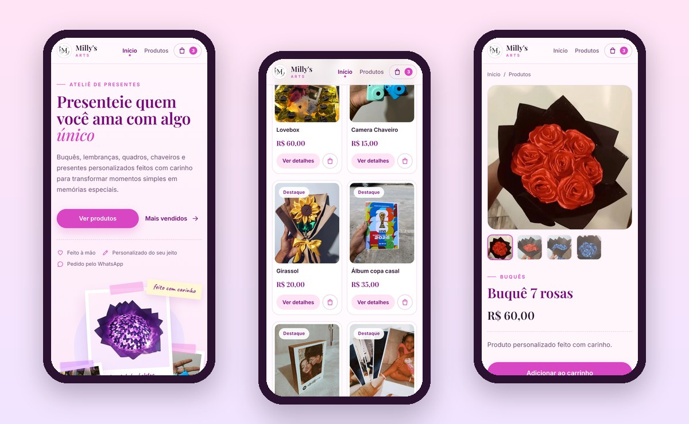

<div align="center">

<a href="https://millysarts.shop"></a>

# Milly's Arts

**Presentes personalizados feitos à mão: buquês, polaroids, quadros, chaveiros e lembranças.**

<a href="https://millysarts.shop"></a>


</div>

<br />

## Sobre

A Milly's Arts é a loja online de um ateliê de presentes. O cliente navega pelo catálogo, monta o carrinho, aplica um cupom e envia o pedido pronto para o WhatsApp, onde a loja combina os detalhes da personalização. Os produtos, fotos e cupons são cadastrados por um painel administrativo, sem mexer no código.

## Telas



<table>
  <tr>
    <td width="50%"></td>
    <td width="50%"></td>
  </tr>
  <tr>
    <td align="center"><sub>Página do produto, com galeria e tamanhos</sub></td>
    <td align="center"><sub>Carrinho, com cupom e resumo do pedido</sub></td>
  </tr>
</table>



## Recursos

- **Catálogo** com filtro por categoria (buquês, chaveiros, quadros, polaroids e outros), ordenação por preço, nome ou novidade e aviso de produto esgotado.
- **Página do produto** com galeria de fotos e escolha de tamanho com preço próprio.
- **Carrinho** salvo no navegador, com quantidade, remoção de itens e **cupons de desconto** com validade.
- **Pedido pelo WhatsApp:** o carrinho vira uma mensagem pronta, com produtos, tamanhos, cupom e total.
- **Painel administrativo** protegido por login: cadastro de produtos com categoria, fotos (convertidas para WebP antes do envio), tamanhos, destaques da página inicial e cupons.
- **Visual** delicado e responsivo, sem frameworks, com fontes Playfair Display, Inter e Caveat.

## Tecnologias

| Área | O que foi usado |
| --- | --- |
| Interface | HTML, CSS e JavaScript puro |
| Login do painel | Supabase Auth |
| Banco de dados | Supabase (PostgreSQL). Tabelas `produtos`, `categorias`, `produto_imagens`, `produto_tamanhos` e `cupons` |
| Imagens | Supabase Storage, bucket `produtos` |
| Publicação | Vercel, no domínio `millysarts.shop` |

## Estrutura

```
millys-artss/
├── index.html        # Página inicial
├── produtos.html     # Catálogo
├── produto.html      # Página de um produto
├── carrinho.html     # Carrinho e envio do pedido
├── login.html        # Entrada do painel
├── admin.html        # Painel administrativo
├── css/              # Estilos (global.css + um arquivo por página)
├── js/               # Lógica de cada página, conexão com o Supabase e efeitos
├── assets/img/       # Logo e imagens da loja
├── docs/             # Imagens deste README
└── server.js         # API do antigo assistente com IA (não é usada pelo site)
```

## Rodando localmente

O site é estático. Basta abrir a pasta com um servidor local:

```bash
git clone https://github.com/Marcello-ribeiro/millys-artss.git
cd millys-artss
python -m http.server 5500
```

Depois acesse http://localhost:5500.

Para usar outro projeto do Supabase, troque a URL e a chave **publicável** em `js/supabase.js`. A chave publicável pode ficar no front-end, desde que as tabelas estejam protegidas por RLS.

## Licença

Distribuído sob a licença MIT.

<br />

<p align="center"><sub>Feito por <a href="https://github.com/Marcello-ribeiro">Marcello Ribeiro</a></sub></p>
